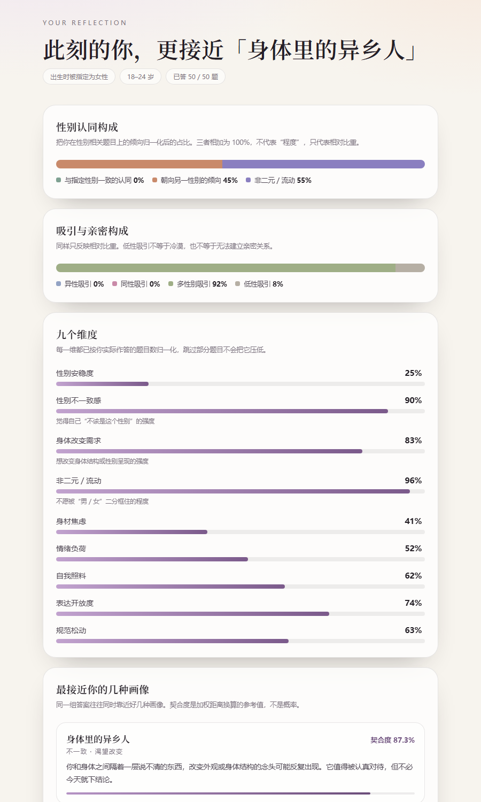

# 我内心究竟是谁 · 50 题自我观察问卷

一份关于**性别、身体、情绪、亲密与日常**的交互式自问卷。50 道题，8–12 分钟，答完给出九维百分比、两组构成比例，以及 3 种最接近的自我画像。

它不是测验，不贴标签，也不做任何诊断——只是把你此刻散落在各处的感受，摆到同一张桌子上。



## 在线体验

> 部署后把这里换成你的 Pages 地址：`https://<你的用户名>.github.io/inner-self-50q/`

## 特性

- **单文件、零依赖**：一个 `index.html`，离线可用，不联网、不上传、不埋点
- **可返回修改**：随时回到上一题，已选答案自动回显；也可以从「题目导航」跳到任意一题
- **自动续答**：答案存在浏览器 localStorage，刷新或关掉页面都不会丢
- **百分比结果**：九维得分 + 性别认同构成 + 吸引构成，各自归一到 100%
- **多种结论**：8 种画像中给出最接近的 3 种及契合度，其余可展开
- **键盘操作**：数字键 1–5 作答，`←` 返回上一题
- **手机友好**：响应式布局，单手可答
- **可导出**：一键复制结果文字，或直接打印 / 存为 PDF

## 50 题结构

| 板块 | 题量 | 关注点 |
| --- | --- | --- |
| 性别认同 | 7 | 性别不一致体验、非二元与流动 |
| 身体与过渡 | 10 | 性转需求、身体改变意愿、呈现方式 |
| 身体意象 | 6 | 身材焦虑、回避、身体部位不适 |
| 情绪状态 | 7 | 低落、睡眠、自我价值、支持系统 |
| 日常节律 | 7 | 作息、饮食、房间、爱好、运动 |
| 吸引与亲密 | 6 | 同性 / 异性 / 多性别 / 低性吸引 |
| 表达与观念 | 7 | 出柜意愿、性别角色态度、标签观 |

## 结果怎么算

- 48 道五级量表 + 2 道直接选择（心动对象、吸引模式）。
- 量表题并非统一反向计分：例如「对声音体型满意」在**性别安稳度**上是正向、在**身体改变需求**上是负向，所以每个选项按维度分别赋权。
- 每个维度的权重总量被拉平，因此「说不清」在各维度上都落在 50% 附近——全选中性时九维都是 50%，不会被某一项莫名顶高。
- 构成比例只统计**高于中性水位**的部分，避免大量中立回答把某一类顶到 60%。
- 画像契合度是加权距离换算的参考值，**不是概率**。

权重、维度和画像都写在 `index.html` 的 `QUESTIONS` / `DIMS` / `ARCHETYPES` 里，想改题目或加维度直接改数据即可。

## 隐私

所有计算都在你的浏览器里完成。没有后端、没有请求、没有统计。答案只写进 `localStorage`，点「重新作答」即清空。

## 免责声明

本问卷**不构成心理、精神或医学诊断**，也没有经过标准化信效度检验。它不能告诉你「你是不是跨性别 / 无性恋 / 同性恋」——那只能由你自己在时间里慢慢确认。

如果你正处在强烈的痛苦中，请优先寻求现实中的专业支持。中国大陆可拨打心理援助热线 **12356**。

## 本地运行

双击 `index.html` 即可，不需要安装任何东西。

想用本地服务器：

```bash
python -m http.server 8000
# 打开 http://localhost:8000
```

## 部署到 GitHub Pages

1. 把本仓库推到 GitHub
2. Settings → Pages → Source 选 `Deploy from a branch`，分支 `main`，目录 `/ (root)`
3. 等一两分钟，访问 `https://<用户名>.github.io/inner-self-50q/`

## License

MIT
